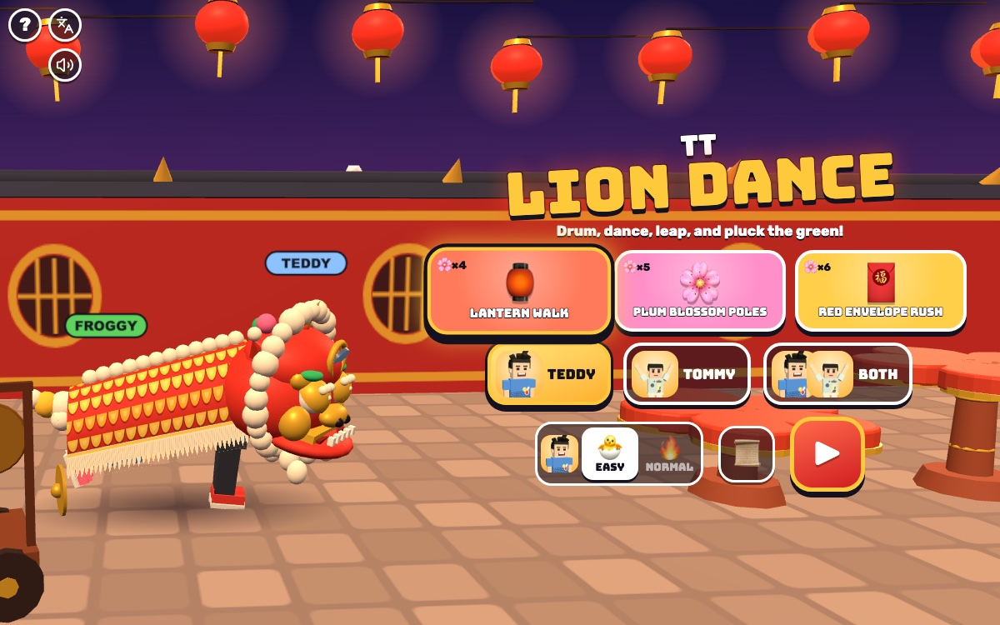

# TT Lion Dance

[](https://adong.github.io/lion-dance-tt/)

Press **?** any time (or tap the round **?** button in the top left corner) to see the keys. The game waits while you look.
Tap the language button under it (the A文 icon) to switch between English and 中文; the dashboard and every game remember the choice.

**中文：** 舞狮节奏游戏：Teddy 当狮头，Tommy 当狮尾，跟着锣鼓敲鼓、打镲、敲锣，狮子就会跳舞、眨眼、摇头，跳过梅花桩，最后采青，撒生菜带来新年好运。

A rhythm game from the 中国 series, about the southern lion dance (醒狮) at Chinese New Year. Two dancers become one lion: Teddy is the head and Tommy is the tail, and you see their legs under the costume. Drums, cymbals and gongs fall onto big pads; hit each one on the beat and the lion nods, blinks, shakes its head and wags its tail, then leaps from one plum-blossom pole (梅花桩) to the next on the gong. At the end it rears up and plucks the green (采青): a lettuce tied to a red envelope, hung high over the last pole. It chews, spits the lettuce leaves out for everyone's luck, takes a bow, and the brothers come out of the costume to celebrate. A short story card (📜) explains it all for the boys, in English and 中文.

It's built with Claude Code from plain JavaScript and Three.js, in the same style as the other Teddy & Tommy games. There are no image, model or audio files: the street, the poles and the lion are spheres, cones and canvas textures, the characters come from the shared kit (`kit/`), and all the music is synthesised. The lion, the songs and the story are our own.

The name lives in one place, [js/title.js](js/title.js).

## Play

- **Double-click `index.html`.** It works offline, because Three.js and the kit are copied into `kit/`. Without internet the logo falls back from the Bungee font to Arial Black.
- **Send one file:** `dist/lion-dance-tt.html` is the whole game in one file. AirDrop or email it, then open it in a browser.
- **Rebuild that file** after any edit: `python3 kit/tools/bundle.py . --name lion-dance-tt`
- **Get kit updates** from `~/claude-games/kit`: `python3 ../kit/tools/sync.py .`, then rebuild.
- **On the home screen** pick a song (it plays its first bars quietly), who dances (TEDDY, TOMMY or BOTH), 🐣 EASY or 🔥 NORMAL for each brother, then ▶. The first time, the story card comes first; 📜 opens it again.
- **Each song** shows its name and READY?, then the woodblock counts in: 3, 2, 1. The lion is asleep until the first gong wakes it up. Songs are about 50 seconds.
- **The end:** the lion bows, the brothers come out, set the lion head down and do their signature moves (Teddy's boxing and his 🏀 jump shot, Tommy's Y with peace fingers ✌️) while confetti flies. Then up to 3 stars, the score, NEW BEST! or your best, and how many PERFECT, GREAT, OK and MISS. 🔁 plays again, ⏭️ the next song, 🏠 the songs.
- **Saved per browser:** the song, who dances, each brother's level, the best score for every song and level, and whether you've seen the story.

### Who's in the lion

| | the head (🥁 drum) | the tail (cymbal) | who plays |
|---|---|---|---|
| TEDDY | Teddy | 🐸 Froggy | Teddy plays the whole lion: drum, gong and cymbal |
| TOMMY | 🦊 Foxy | Tommy | Tommy plays the whole lion |
| BOTH | Teddy | Tommy | each brother plays his half: Teddy the drum, Tommy the cymbal, and both hit every gong |

Foxy and Froggy are the CPU friends, the same as in TT Go and TT Chess ([js/friends.js](js/friends.js)).

### EASY and NORMAL

| | 🐣 EASY (Tommy, 5) | 🔥 NORMAL (Teddy, 8) |
|---|---|---|
| pads | 2: drum and cymbal (2 players: 1 each). A gong can be hit with **any** pad ("ANY PAD!") | 3: drum, gong, cymbal (2 players: 2 each, the gong and your own) |
| notes | only on the beats, about one every two beats | eighth notes |
| falling | slow: 2.3 s | 1.7 s |
| timing window | PERFECT ±75 ms, GREAT ±140 ms, OK ±210 ms | ±45, ±90, ±135 ms |
| a miss | the lion wobbles, the combo starts again | the same, and the lion's spirit meter drops |
| the song ends early | never: the lion always reaches the green | if every player's meter runs out ("THE LION IS TIRED!") |
| stars | at least 1 for dancing to the end | 0 to 3 |

- **Stars** come from points against a perfect run (PERFECT 300, GREAT 200, OK 100): 40 % is one star, 70 % two, 90 % three. The score adds a combo bonus, up to double at a 40 combo.
- **The spirit meter** (NORMAL) starts at 60 %; hits fill it a little, a miss takes 8 %, a treat from your brother gives 25 %. In 2 players each brother has his own meter and level, so Teddy can play NORMAL while Tommy plays EASY; the one with more stars (then points) gets a 👑.

## The songs and the story

Three songs of our own, in [js/songs.js](js/songs.js): a pentatonic tune (flute, sheng or suona-like lead), a bass, plucked guzheng-like strings, and the lion dance band: the big drum (大鼓), cymbals (镲), the gong (锣) and a soft woodblock on every beat to help the boys keep time.

| | Song | Tempo | Poles | Length | 🐣 notes | 🔥 notes |
|---|---|---|---|---|---|---|
| 🏮 | Lantern Walk | 90 BPM | 4 | 54 s | 37 | 73 |
| 🌸 | Plum Blossom Poles | 104 BPM | 5 | 51 s | 41 | 83 |
| 🧧 | Red Envelope Rush | 120 BPM | 6 | 52 s | 49 | 98 |

Every song tells the same story, in sections of bars: **wake** (the first gong opens its eyes; it blinks and shakes), **walk** (it dances up to the poles, a step on every beat), **poles** (every 2 bars the gong is the leap, and it lands one beat later on a drum), **the green** (a gong to rear up: the tail lifts the head; the cymbal two beats later plucks it), **the leaves** (a gong: it spits the lettuce leaves and 🧧 for luck), and **the bow** (the last gong).

- **The charts** are bar patterns of 8 slots (eighth notes) in pairs, NORMAL and EASY, so EASY is always part of NORMAL note for note, and the music plays a drum, cymbal or gong under every note.
- **The lion's moves happen on the music's time** whether or not a note was hit, so it never gets stuck and EASY always reaches the green. Hits make it move: the drum nods and opens the mouth (and sometimes blinks), the cymbal shakes the head and wags the tail, a gong roars; a PERFECT gong sparkles. A miss makes it wobble.
- **The sound** plays through `Kit.sound.tone` / `Kit.sound.hiss`, scheduled 0.2 s ahead on the AudioContext clock, so the kit's sound switch mutes everything. Like TT Dance Party, [js/audio.js](js/audio.js) wraps the AudioContext constructor to get the kit's context, and [js/clock.js](js/clock.js) follows the audio clock, with a `performance.now()` fallback while the sound is suspended.

## Controls

| 1 player | 2 players | Touch | |
|---|---|---|---|
| `A` `J` `←` | Teddy `A` | the 🥁 DRUM pad | drum |
| `S` `K` `↓` `Space` | Teddy `D`, Tommy `←` | the GONG pad (EASY: any pad) | gong |
| `D` `L` `→` | Tommy `→` | the CYMBAL pad | cymbal |
| `T` / `Enter` | `T` / `Enter` | the round face (✋ in 2 players) | call your brother · high five |
| `P` / `Esc` | | ⏸️ button | pause (▶ keep dancing, 🔁 start again, 🏠 songs) |
| `M` | | 🔊 button | sound on / off |

On the home screen: `←` `→` (or `A` `D`) pick a song, `↑` `↓` (or `W` `S`) the level (with both playing, `W` `S` is Teddy's and `↑` `↓` Tommy's), `1` `2` `3` who dances, `B` the story, `Enter` or `Space` to dance. On the results, `Enter` plays again, `N` the next song, `Esc` home.

- **The pads** sit at the bottom under their lanes (on a wide screen, on the right; with two players, Teddy's on the left and Tommy's on the right, the lion in the middle). They're 78 px on a phone held upright with 4 lanes, 72 px on a phone held sideways, 118 px on an iPad.
- **The kit's buttons** (? and A文, and the speaker on menus) sit in the top left corner, above the lanes, which start lower.

## Companion

Call your brother any time, as often as you like: **T** or **Enter**, or tap his face. He's `Kit.roster.buddyFor(you)`: Tommy when Teddy plays, Teddy when Tommy plays.

- **He hops in** at his buddy size (`buddyScale`, with a name tag) and says hello with his signature move (Teddy: boxing; Tommy: the Y with peace fingers).
- **He tosses the lion a treat** (🍦 💧 🧃 🍪 🍉 🍌), which it chews: "🍪 COOKIE FROM TOMMY!" On NORMAL it fills the spirit meter by 25 %.
- **Then he climbs onto the band's cart and plays the big drum:** "TOMMY SAYS: I'LL PLAY THE BIG DRUM!" For 8 seconds the timing windows are twice as wide, the lanes glow gold and the notes glow. Then a goodbye (Teddy: his 🏀 jump shot) and he hops off. Calling again while he's there brings another treat and starts the 8 seconds again.
- **When both brothers play,** they're both in the lion already, so T or Enter is a high five: the head turns back, the tail jumps up, ✋.

## How it was checked

Nobody listened (Alan works next to the sessions): it was tested muted, and sound was checked in code.

**Headless, in Node:** `node tools/check.js` (or `game.check()` in the page) runs [js/checks.js](js/checks.js) on the page's own songs and judging. All pass:

- **grid:** every note of all 6 charts is on the beat grid to within 1 ms: eighth notes on NORMAL, beats on EASY.
- **sound:** a drum, cymbal or gong of the same kind sounds under every note. **subset:** EASY is part of NORMAL. **playable:** no player gets two notes closer than his grid; **players:** in 2 players both brothers get plenty of their own notes, in every section.
- **story:** the first note is the waking gong at 0 s; reach, pluck (2 beats later), spit and bow, each once, in order, after the last landing.
- **poles:** one leap per pole, each from a gong on a bar's first beat, lasting exactly one beat, landing on the beat on a drum, nothing to hit in the air, on top of the right pole; the route never jumps more than 0.25 m in a 120th of a second, and ends on the last pole.
- **easy:** EASY never fails the song: missing everything, or mashing, on every song, for 1 player, the head and the tail, finishes with a star and the lion on the last pole. **normal:** NORMAL missing everything does run out.
- **perfect:** pressing every note on time gives every note PERFECT and 3 stars, for every song, player and level. **boost:** the big drum doubles the window.
- **The checks can fail:** `node tools/check.js` and `game.prove()` break each rule on a copy (a note 30 ms off the grid, a missing drum under a note, a swapped EASY note, two notes 50 ms apart, a tail with no cymbals, no pluck, a leap of 1.5 beats, a walk that ends 1.5 m off, an EASY that can fail, a NORMAL that can't, a player 60 ms late, a drum that doesn't help) and each one is caught.

**In the Browser pane** (time driven by `game.step()`, since the hidden pane holds back animation frames):

```js
localStorage.setItem('claudeGames.muted', '1')   // always, before anything plays; then reload
game.autopilot(true)                             // every note pressed right on time
game.start({ song: 'plum', who: 'both', levels: { teddy: 'normal', tommy: 'easy' } })
game.step(10)                                    // 10 s at 60 fps, drawn
game.call(); game.pause(); game.resume()
game.state()                                     // song time, players, lion, brother, outcome
game.tick(dt)                                    // one live frame on the real clocks, for the sound check
game.soundCheck()                                // what really got scheduled against the song
```

- **Real audio, muted:** with `Kit.sound.init()` from JS (master gain 0) and the AudioContext running, the song clock ran on the audio clock, and every scheduled sound landed exactly on its song event, every note included (23 of 23 in 6 s). Pausing froze the clock; after resuming it gained 3.01 s in 3 s and kept the same audio anchor (18 of 18 exact).
- **Flows:** all three songs to the end with the autopilot, 1 player EASY and NORMAL and 2 players (wake, walk, every pole, the green, the leaves, the bow, the reveal, results with 3 stars); a NORMAL run with no presses ending in THE LION IS TIRED!; the brother's whole visit (hop in, hello, treat, drum, boost 8 s, goodbye); the 2-player high five.
- **Screens:** desktop and iPad landscape (1024 x 768), iPad portrait (820 x 1180), phone portrait (390 x 844) and landscape (740 x 360), 1 and 2 players, up to 4 lanes.
- **中文:** with `Kit.lang.set('zh')`, home, the story, the ? panel, playing (1 and 2 players), the brother's visit, every treat, pause, the end and both kinds of results: `Kit.lang.untranslated()` is `[]`. In English mode no Chinese is on the page except the kit's language button tooltip, which names the language a tap switches to. In 中文 the logo adds 舞狮 under the English name.
- **Offline:** the single page `dist/lion-dance-tt.html` opened from `file://` in headless Chrome with the network blocked and drew the title screen (the logo in Arial Black). The screenshot is the same page online. No console errors in the Browser pane.

## Files

```
index.html       page, menus, HUD, pads, the story card and overlays (CSS inline)
js/title.js      the game's name, in one place
js/friends.js    Foxy and Froggy (the CPU friends), as in TT Go
js/songs.js      the three songs, the bar patterns, the charts and the lion's route over the poles (runs in Node)
js/clock.js      the song clock: the audio clock with a performance.now() fallback
js/engine.js     judging, score, combo, stars, the spirit meter (runs in Node)
js/checks.js     the headless checks and their proofs (game.check(), game.prove(), tools/check.js)
js/audio.js      the band and the tune, the look-ahead player on the AudioContext clock, the effects
js/stage.js      Three.js: the street, lanterns, plum trees, the poles, the green, the drum cart, the camera
js/lion.js       the lion: head, cloth body, fringe and tail, the dancers inside, its moves, the reveal
js/lanes.js      the layout, lanes, falling instruments, pop-ups, sparkles and confetti (2D canvas)
js/buddy.js      calling your brother: hop in, signature, treat, the big drum; the 2-player high five
js/game.js       screens, the song loop and story moments, input, pads, HUD, results, window.game
js/keys.js       the keys the ? panel shows (Kit.help)
js/zh.js         中文 (Kit.lang); names and the game's name stay English
tools/check.js   the headless checks in Node
kit/             copy of ~/claude-games/kit; edit the kit there, not here
dist/lion-dance-tt.html  the single-file build
```

## Not verified

- **The music and sounds:** nobody has listened. The timing is checked in code, but whether the tunes, the drum, cymbals and gong and the mix sound good is untested.
- **Real touch devices and iOS Safari:** pads use pointer events, tested by script and in phone and iPad emulation, not with real thumbs.
- **Bluetooth latency:** there's no timing screen; with late speakers the notes may feel early.
- **Frame rate on an iPad,** and how hard it is for real kids.
- **Cultural detail:** the lion, music and story were written from general knowledge of the southern lion dance; a family member who knows it well may want to check the words in the story card.
